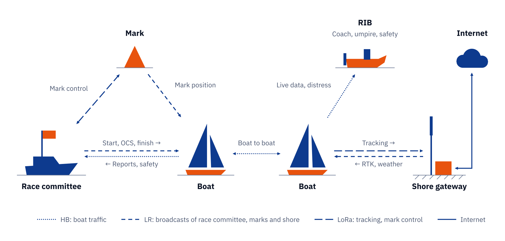

**OpenBoatLink (OBL)** is an open radio protocol for boats. One radio link carries live tracking, electronic starts, umpiring support, coaching data and safety functions, and devices from different manufacturers work together.

`v0.7` &nbsp; `2026-11-17` &nbsp; `CC BY 4.0` &nbsp; 

## At a glance

What each part sends, and in which mode: [System overview](spec/03-system-overview.md#components).

Each boat carries a small device with satellite positioning and radio. Boats, marks, the race committee and coach boats receive each other directly, without internet.

| For | What OBL gives you |
| --- | --- |
| Sailors | Countdown and distance to the starting line on board. A signal to your boat if you are on the course side at the start (OCS). Live tracking and replay. |
| Race committees | Start sequence, recalls, course changes and finishes over one radio link that reaches every boat. |
| Umpires and coaches | Positions, headings and sensor data of the boats in real time. |
| Clubs and organisers | Affordable devices, no set-up on the boats, and one system from club racing to the Olympic Games. |
| Manufacturers | A public, royalty-free specification and a shared code library. |

## Read on

Three short pages and the FAQ. Each starts with a summary in plain words.

| | Page | What it tells you |
| --- | --- | --- |
| 1 | [Motivation and use cases](spec/01-motivation-and-use-cases.md) | Why an open protocol, and what it is used for on the water |
| 2 | [Requirements and performance tiers](spec/02-requirements-and-tiers.md) | What the system must deliver, and which device tier suits which event |
| 3 | [System overview](spec/03-system-overview.md) | The parts of the system and how they work together |
|  | [FAQ](spec/faq.md) | Why this radio band, why not AIS or mobile network trackers, and what a device costs |

These pages are the first five chapters of the specification and its FAQ; the sources are listed under [References](spec/references.md). The technical chapters (radio, messages, security, racing procedures) are still being edited and will follow here.

## Status

Draft v0.7. Wording and values can change until version 1.0.

## Licence and brand

- Specification text: [CC BY 4.0](LICENSE). If you reuse it, credit "OpenBoatLink (OBL) specification" and link to this repository.
- Code, once published: Apache License 2.0.
- Name, logo and conformance marks: use them as the [brand guide](brand/README.md) says.

## Feedback

Questions, comments and corrections are welcome as [issues](https://github.com/ursminor/OpenBoatLink/issues).
