
<a href="../README.md">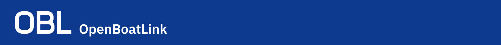</a>

[OpenBoatLink](../README.md) › Brand

# OBL Corporate Identity

Version 1.4, 2026-11-16. Logos in `logo/`, images of this document in `img/`.

## Principle

OBL looks like a standard, not a product: dry, exact, legible. The letters OBL carry the identity. OBL Blue dominates; signal orange only where something needs attention, and in pictograms.

## Name

- Full name `OpenBoatLink`, one word. Short form `OBL`, capitals. First mention: "OpenBoatLink (OBL)", then OBL.
- Never "Open Boat Link", "Obl", "O.B.L.".
- Scope: radio protocol for boats in general. Don't write "for sailboat racing".
- "OBL Tier n" on a product only with a published Implementation Conformance Statement (ICS) declaring that tier.

## Lettermark

Letters OBL only, constructed on a grid. No symbol. Never retype in a font.

| Item | Value (grid units u, 1 u = cap height / 24) |
| --- | --- |
| Size | 60 × 24 u (5:2) |
| Stroke | 4 u, monoline |
| Letter spacing | 3 u |
| O | 20 u wide, outer radius 8, inner 4 |
| B | upper bowl 18 u, lower bowl 19 u, bar 10–14 u, bowl radius 6, inner 2, stem corners square |
| L | 15 u wide, square corners |
| Clear space | 12 u (half the height), all sides |
| Minimum size | 12 px screen, 4 mm print; smaller: write OBL in text |

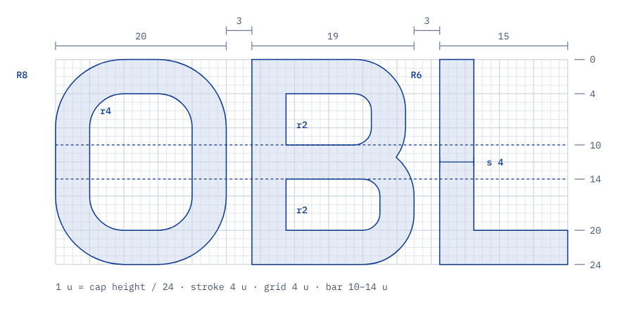

- Colours: blue on white (primary), white on OBL Blue, black for one-colour print, engraving, laser. Nothing else; never orange.
- Don't stretch, rotate, outline, re-space, add shadows or gradients, or combine with boat, wave or antenna symbols. Not on busy photos without a blue field.

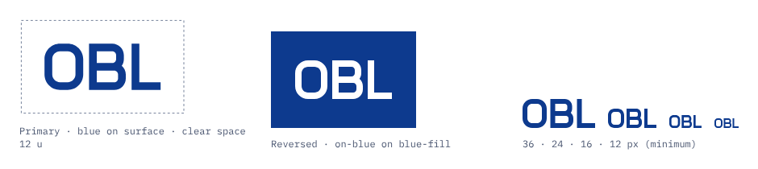

## Lockup, icon, conformance mark

- Lockup: lettermark + "OpenBoatLink" in IBM Plex Sans SemiBold, cap height 10 u on the lettermark baseline, gap 8 u. For first contact: website header, title slide, poster. Lettermark alone elsewhere.
- Icon: white lettermark on an OBL Blue square, 6 u side margin. Avatars, favicon, GitHub, app icons.
- Conformance mark: blue cell with white OBL, white cell with "TIER 1/2/3" in blue, 2 u blue frame. Only with published ICS for that tier. Minimum 32 px / 8 mm. Never recolour.
  - Tier 1: RTK, Olympic level. Tier 2: championships, about 1 m. Tier 3: club racing, any GNSS.

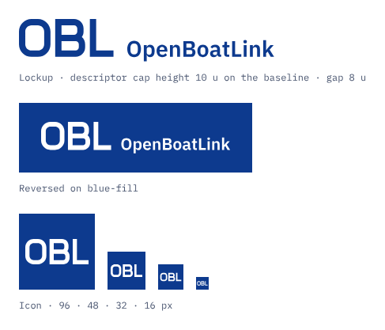

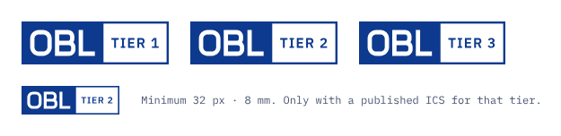

## Colour

| Token | Light | Dark | Use |
| --- | --- | --- | --- |
| `blue` | #0D3A8E | #86A8EE | OBL Blue as text, rules, marks, lettermark |
| `blue-fill` | #0D3A8E | #1A4AA8 | Blue fields: covers, header bands, conformance mark |
| `on-blue` | #FFFFFF | #FFFFFF | Text on blue-fill |
| `blue-tint` | #E5EBF6 | #11234A | Table heads, callouts |
| `ink` | #0B1324 | #E8EDF7 | Text |
| `ink-muted` | #4A5670 | #A5B1C8 | Metadata, captions, link labels |
| `surface` | #FFFFFF | #08132B | Ground |
| `surface-sunken` | #F2F4F8 | #050D1F | Code blocks, alternate rows |
| `line` | #CFD6E2 | #26385E | Decorative hairlines |
| `line-strong` | #6F7C96 | #61739A | Borders that carry meaning, waterlines |
| `orange` | #E8530E | #FF7A3D | Signal: attention, pictogram accents |
| `on-orange` | #0B1324 | #0B1324 | Text on orange |
| `focus` | = blue | = blue | Focus ring, 2 px, 2 px offset |

- OBL Blue is the only brand colour. Large fields are blue with white text.
- Orange: at most one element per view or figure, always with a word (OCS, DRAFT, DISTRESS). Exception: pictograms (below). Never orange text on light grounds, never orange on blue, never in the lettermark.
- No gradients, shadows or transparency effects.
- Print: RGB 13 58 142. CMYK and Pantone not fixed yet; match the HEX value on a proof.
- All text pairs meet WCAG 4.5:1 in both themes.

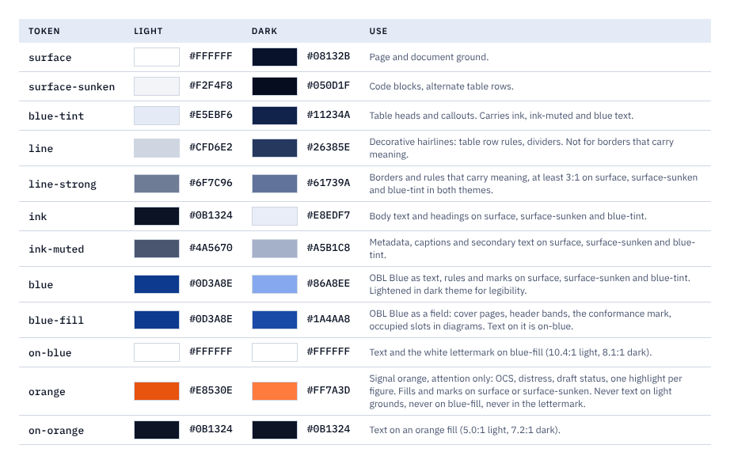

## Type

- IBM Plex Sans and IBM Plex Mono, SIL Open Font License 1.1, free for any use.
- Plex Sans 400 text, 500 emphasis, 600 headings. Plex Mono for anything a machine reads: hex, bit fields, field names, code, values with units in tables.
- Sentence case. Capitals with 0.08 em tracking only for labels and table heads.
- Fallback without Plex: Arial, Consolas.

| Style | Font | Size / line | Weight | Use |
| --- | --- | --- | --- | --- |
| display | Sans | 40/44 px | 600 | Page and document titles |
| h1 | Sans | 28/34 px | 600 | Chapters |
| h2 | Sans | 20/28 px | 600 | Sections |
| h3 | Sans | 16/24 px | 600 | Subsections |
| body | Sans | 15/24 px | 400 | Running text, 60–75 characters per line |
| small | Sans | 13/20 px | 400 | Captions, notes, table cells |
| label | Sans | 11/16 px | 600 | Eyebrows, table heads, capitals |
| code | Mono | 13/20 px | 400 | Code |
| data | Mono | 13/20 px | 500 | Values in tables and diagrams |

Word and PDF: body Plex Sans 10/14 pt; heading 1 18 pt SemiBold blue; heading 2 13 pt SemiBold; heading 3 11 pt SemiBold; tables 9 pt, head row on blue-tint; code Plex Mono 9 pt on surface-sunken.

Slides: names 14 pt bold, labels 12 pt, captions not below 10 pt.

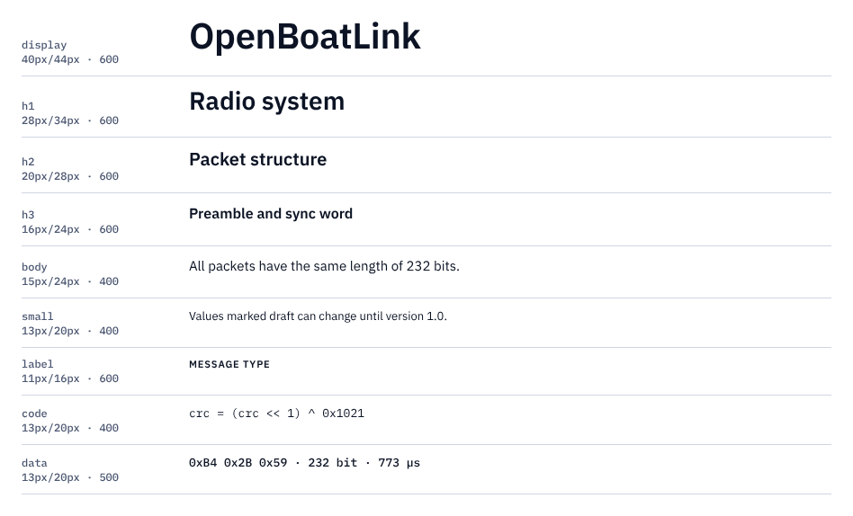

## Layout

- Spacing on a 4 px scale: 4, 8, 12, 16, 24, 32, 48 px. Page gutter at least 16 px; slide margins at least 0.5 in.
- Square corners everywhere. 2 px radius only for inline code.
- Rules, not boxes: 1 px hairlines between rows, 2 px blue rule under a document title. No cards with shadows, no accent stripes.

## Documents

- Title block: label "Specification", title, one-line subtitle, meta row in Plex Mono (version, ISO date, licence, status tag), 2 px blue rule. Lettermark 24 px top right.
- Status tags, capitals, square: MANDATORY (blue fill, white text) = reference module used unmodified; RECOMMENDED (blue outline) = may be replaced; INFORMATIVE (grey outline) = not a requirement; DRAFT (orange fill, ink text) = can change until 1.0, once per heading.
- Tables: head row on blue-tint in label style, 1 px row rules, no vertical rules, no zebra. Numbers right-aligned in Plex Mono. Total row closes with a 2 px blue rule.
- Diagrams: line-strong for structure, line for empty elements, blue fields, Plex Mono 11 px labels, one orange element at most with a legend word. Say "schematic" when not to scale.

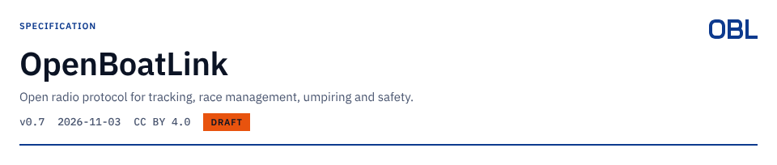

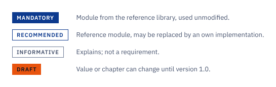

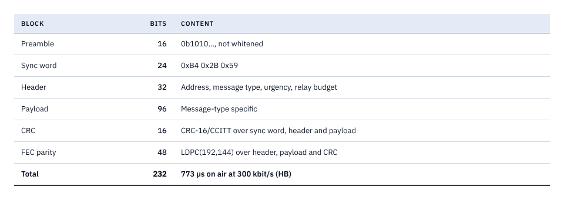

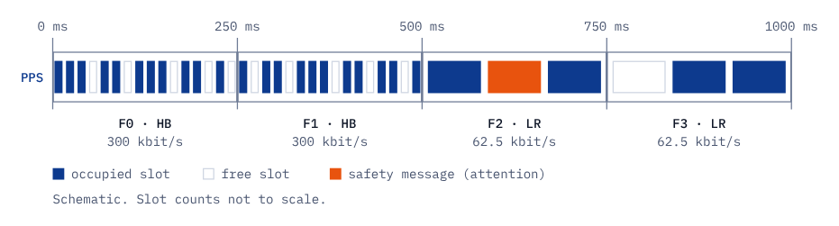

## Pictograms

- Flat side-view silhouettes in OBL Blue. No outlines, no shading, no gradients. Each object on a short waterline in line-strong.
- Each physical object has exactly one orange part: race committee flag, boat hull, RIB hull, mark (pyramid), gateway unit. Sails, cabins, masts, consoles stay blue. Abstract symbols (internet cloud) blue only.
- Boat: hull, mainsail, jib only, so it reads as dinghy or yacht. Mark: pyramid. RIB: hull, console, outboard. Shore gateway: pole with antenna (radome) and unit on a hatched ground line. Internet: cloud.
- Radio links: dashed blue, 1.75 pt, arrowheads show direction. Wired links (internet) solid, routed at right angles, never in line with an antenna.
- Names 14 pt bold ink; link labels 12 pt ink-muted. Two-way links with different content: label each direction with → and ←.
- No decorative patterns such as slot grids or bit patterns: they read as Morse code.

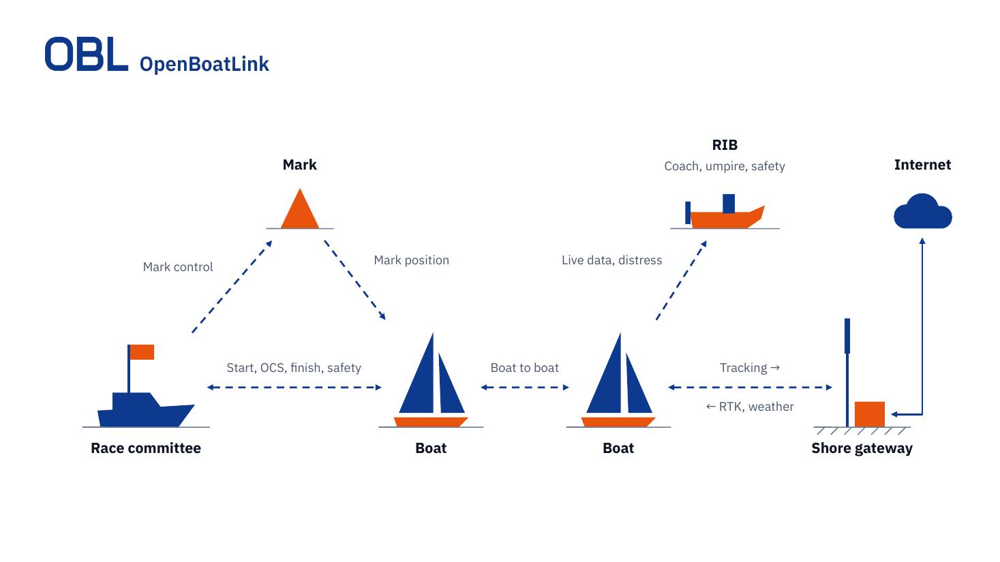

## Writing

- Engineering style. Short sentences. No marketing adjectives, exclamation marks or emoji.
- Requirement words as in the specification: shall, should, may, lower case.
- SI units with a space: 868 MHz, 250 ms, 300 kbit/s. Hex 0x, binary 0b. Dates ISO 8601.
- Licences: specification CC BY 4.0, code Apache 2.0.

## On GitHub

GitHub sets its own fonts and colours. The identity shows in three elements:

- Banner on the start page: blue field, white lockup, the line "Open radio protocol for boats" (`img/banner.svg`).
- Header band on every other page: blue field, white lockup, linked to the start page (`img/header.svg`).
- Meta row under the title: version, ISO date, licence in code style, then the status tag (`img/tag-draft.svg`).

The overview picture on the start page is the pictogram slide without its title (`img/overview.jpg`).

## Files

| What | Where |
| --- | --- |
| Logos SVG: lettermark, lockup (blue, white, black), icon, tier 1–3 | `logo/svg` |
| The same as PNG, and the icon in 32, 180 and 512 px | `logo/png` |
| Banner, header band, draft tag and overview picture for GitHub pages | `img/banner.svg`, `img/header.svg`, `img/tag-draft.svg`, `img/overview.jpg` |
| Images in this document | `img` |
| Fonts | IBM Plex Sans and IBM Plex Mono from [github.com/IBM/plex](https://github.com/IBM/plex); not copied here |

All SVGs are outlined; no font needed to display them.

## Open

- CMYK and Pantone values for OBL Blue and orange.

## Change log

- 1.4: moved to GitHub (`brand/`); section "On GitHub"; file locations updated.
- 1.3: code licence Apache 2.0 instead of MIT.
- 1.2: illustrations added (construction, logo variants, colours, type, document elements, pictograms); header logo on blue.
- 1.1: cover graphic removed; pictogram rules; scope "for boats".
- 1.0: first version.
