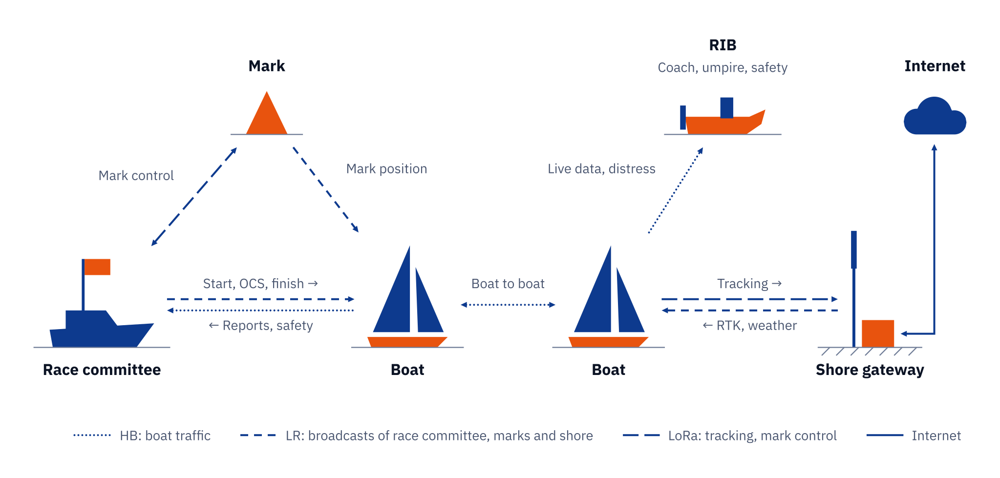

[OpenBoatLink](../README.md) › [Specification](README.md) › System overview

# System overview

`v0.7` &nbsp; `2026-11-17` &nbsp; `CC BY 4.0` &nbsp; 

> **In short.** Each boat carries a small device with satellite positioning and radio. Boats, marks, the race committee and coach boats receive each other directly, without internet. This page names the parts of the system and explains the principle; the radio details follow in later chapters.

OBL builds on proven techniques. More than 150,000 aircraft and mining vehicles already exchange data for safety and productivity with similar protocols, such as FLARM and ADS-L, the EASA specification for electronic conspicuity of aircraft (see [References](references.md)).

For race management, OBL provides the functions of an Augmented Race Management System (ARMS), the World Sailing term for electronic start timing and OCS identification.

## Components

Schematic. The parts of the system and the radio modes they use; the line in the picture shows the mode (details under [Principle of operation](#principle-of-operation)):

| Part | What it is | Radio mode, line in the picture |
| --- | --- | --- |
| **Boat node** | GNSS receiver and sub-GHz transceiver on each boat, standalone or built into other equipment such as race computers or instruments. Sends tracking, information, telemetry, start, finish and zone report messages; receives race management and RTK messages. | **HB**, high bandwidth, fine dots: fast, short range. Everything the boat sends, apart from LoRa. **LoRa**, long dashes: very slow, longest range. Its position every 10 to 45 s, with track points much denser. |
| **Infrastructure nodes** | Equipment of the organizing authority. Committee node (race management, optional RTK base node), mark nodes on anchored or robotic marks (tracking, telemetry, weather), umpire, coach and rescue boats (receivers, optional relay nodes). | **LR**, long range, dashes: slower, reaches the whole course. Broadcasts of the race committee, marks and shore stations. **LoRa**, long dashes: commands to robotic marks and their answers, also 5 km and more from the committee boat. |
| **Relay nodes** | Infrastructure nodes that retransmit selected packets once to extend coverage. Boat nodes do not relay. | The mode of the packet they relay, HB or LR. In LoRa they relay only distress calls and mark control, not routine tracking. |
| **Gateway nodes** | Receivers that forward radio traffic to the internet and inject shore traffic into infrastructure slots (see Gateways). | Receive HB, LR and LoRa; send in LR, for example RTK corrections and weather. Internet, solid line. |
| **Backend** | Aggregation, live tracking, storage and replay. Out of scope of this specification. | Internet, solid line. |

## Principle of operation

All devices are synchronized to UTC by GNSS. Airtime is divided into one-second cycles of four 250 ms frames. Two high bandwidth (HB) frames carry the traffic of the boats. One long range (LR) frame carries the broadcasts of the infrastructure. Both use a fast modulation, GFSK. The fourth frame is left to LoRa, a slower modulation with much longer range. HB and LR frames use separate channels, chosen per region to match its access rules. Each frame has fixed slots (1 ms in HB, 4.25 ms in LR). Every GFSK packet is 232 bits long and fits one slot.

Devices choose free slots based on what they receive (occupancy map) and keep a slot that works (sticky slots). The fleet converges to a low-collision pattern without registration, pairing or a master station.

A position takes 40 bits at 4.44 cm resolution (relative coordinate encoding). Speed and rate of turn use nonlinear exponential encoding. Each device predicts its own track from its last transmitted report and sends an extra report only when the actual position deviates from the prediction (extrapolation-based reporting). Receivers use the same prediction between reports. Under high load, boats on steady courses report less often and leave airtime to boats that manoeuvre. The chapter Capacity and scaling gives the budget.

In addition, every boat sends a LoRa packet every 10 to 45 s with its latest fix and its recent track. The packets are sparse, but the track is dense: each packet adds five track points, four of them where the boat turned, and the curve through them follows her path typically within 0.3 to 2 m. LoRa reaches much further than the GFSK modes and covers the whole course, also in races over long distances (see LoRa tracking).

## Zero configuration

Boat devices are not configured for a regatta or a course. They take all settings from three sources:

- **GNSS position:** selects the regulatory region, and with it the channel plan and power limits.
- **Channel load**, measured in the occupancy map: sets reporting rate and deviation threshold.
- **Event settings**, broadcast by the organizer's infrastructure (race management message, subtype 5): event identifier, authentication and encryption mode, HB channel set, rate limits and course area geofences; LoRa tracking settings follow in subtype 7. Course areas do not overlap; a device selects its course area by position.

Without infrastructure in range, a device uses defaults. Only the organizer's equipment (committee boats, marks, relays, gateways) is configured. The one exception on boats is the boat class: a device may be set semi-permanently to the class of its boat. It sends the class in its information message and ignores race management messages for other classes.

---

← [Requirements and performance tiers](02-requirements-and-tiers.md) &nbsp;·&nbsp; [FAQ](faq.md) →

Chapters named after "see" that are not listed in the [contents](README.md) are not published here yet.
